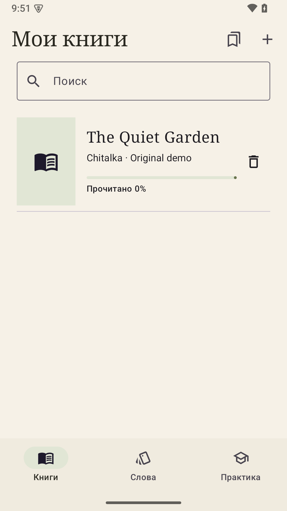
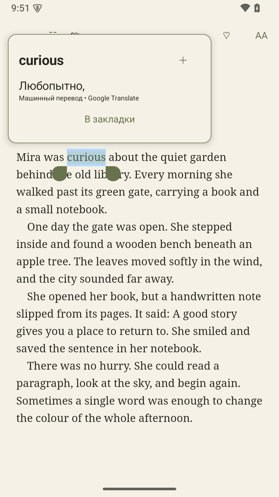
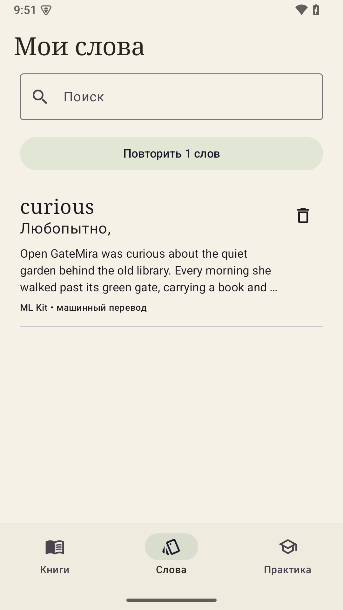

# Читалка · Android

Локальная EPUB-читалка для английских книг с русским переводом, личным словарём и закладками цитат.

**Статус:** технический прототип 0.1.1, Android 8.0+. [Предварительные версии APK](https://github.com/Lyrathorne/chitalka/releases).

Исходники и подготовленные версии публикуются в этом репозитории. APK выкладываются в GitHub Releases с тегами `vX.Y.Z`; тестовые версии помечаются как pre-release. Бинарные APK не добавляются в историю Git.

<p>
  
  
  
</p>

## Разработка

- Android Studio с JDK 17+ (проверка сборки: встроенный JDK 21).
- Android SDK 35, minSdk 26.
- Kotlin 2.2.21, AGP 8.13.1, Gradle Wrapper 8.13.
- Readium 3.1.2, Compose, Room, ML Kit Translation; версии закреплены в Gradle.
- Создайте `local.properties` с `sdk.dir=C\:/Users/<user>/AppData/Local/Android/Sdk` (двоеточие в properties экранируется).

PowerShell из корня проекта:

```powershell
$env:JAVA_HOME = 'C:\Program Files\Android\Android Studio\jbr'
rtk proxy .\gradlew.bat :app:assembleDebug :app:testDebugUnitTest :app:lintDebug
```

APK: `app/build/outputs/apk/debug/app-debug.apk`. Это debug-сборка для проверки, не публичный release.

На Windows при ошибке `ClassNotFoundException` в JVM-тестах из пути с кириллицей перенесите только выходные файлы сборки в ASCII-каталог:

```powershell
rtk proxy .\gradlew.bat :app:assembleDebug :app:testDebugUnitTest :app:connectedDebugAndroidTest :app:lintDebug -PchitalkaBuildRoot=C:/AndroidBuilds/chitalka --max-workers=4
```

Тогда APK и отчёты находятся в `<chitalkaBuildRoot>/app/outputs/` и `<chitalkaBuildRoot>/app/reports/`; исходники остаются в папке проекта. Для выдачи APK копируется в `outputs/chitalka-0.1.1-debug.apk`.

`rtk proxy` — необязательная локальная обёртка; без неё команды запускаются непосредственно через `gradlew.bat` / `./gradlew`.

Инструментальные проверки при запущенном эмуляторе:

```powershell
rtk proxy .\gradlew.bat :app:connectedDebugAndroidTest
```

## Использование прототипа

1. Нажмите «＋» в библиотеке и выберите EPUB без DRM.
2. Откройте книгу. Касание середины скрывает управление, краёв — перелистывает.
3. Удерживайте слово для перевода. При первом использовании нажмите «Загрузить переводчик»: откроется экран состояния с индикатором, временем ожидания и объёмом скачанных данных. Для первоначальной загрузки нужен интернет. К экрану можно вернуться из библиотеки или настроек чтения; закрытие карточки слова загрузку не отменяет.
4. Нажмите «＋» в карточке, чтобы сохранить слово и контекст.
5. Расширьте выделение и выберите «В закладки», чтобы сохранить цитату.
6. Список цитат открывается из библиотеки и из книги. Касание подсвеченной цитаты открывает заметку.
7. В «Практике» доступны простые карточки с записью оценок. Интервальное расписание пока не реализовано.

## Устройство кода

- `data/`: Room, импорт, проверки ZIP, перевод, нормализация.
- `reader/`: Readium, прогресс, выделение, перевод, закладки, настройки DataStore.
- `ui/`: предварительная цветовая тема.
- `MainActivity.kt`: библиотека, слова и простые карточки.

Книги копируются во внутреннее хранилище. Слова и цитаты хранятся в Room. Удаление книги сохраняет слова и цитаты; повторный импорт того же файла связывает их по SHA-256.

## Ограничения

- Пока используется только машинный перевод ML Kit, без полноценного англо-русского словарного пакета и лемматизации.
- Проверки архива ограничивают размер, число записей и небезопасные пути. Работа с активным содержимым EPUB и внешними ресурсами ещё требует отдельной проверки и ограничения до публичного выпуска.
- Интерфейс и расположение переводной карточки требуют проверки на физических устройствах.
- Экспорт и восстановление, расширенные карточки, автосохранение и тесты знаний пока не реализованы.
- Выпуски пока предварительные; постоянная release-подпись ещё не настроена.

## Загрузка модели в 0.1.1

Единое состояние загрузки принадлежит приложению, а экраны наблюдают его через StateFlow. ML Kit подтверждает готовность; прогресс архива берётся через публичный DownloadManager для загрузок этого приложения. Когда размер ещё неизвестен или недоступен, интерфейс показывает ожидание без фиктивного процента. Полученный файл и готовая к переводу модель — разные этапы.

Экран можно закрыть и продолжать чтение. После полного завершения процесса состояние модели и активные системные загрузки проверяются заново; поведение при принудительной остановке Android ещё требует отдельного теста.

## Источники и лицензии

- [Readium Kotlin Toolkit](https://github.com/readium/kotlin-toolkit/tree/3.1.2), BSD-3-Clause. Используется как библиотека, исходники примера приложения не копируются.
- [Google ML Kit Translation](https://developers.google.com/ml-kit/language/translation), [требования атрибуции](https://developers.google.com/ml-kit/language/translation/translation-terms).
- Демонстрационная книга в `app/src/main/assets/sample.epub` содержит специально написанный для тестов текст; воспроизводится командой `rtk proxy python tools/create_fixture.py`.
- Лицензионные уведомления для публичной сборки ещё нужно собрать и проверить.

План с чекбоксами: [docs/ROADMAP.md](docs/ROADMAP.md). Результаты проверок: [docs/VALIDATION.md](docs/VALIDATION.md).

## Публикация версий

`tools/github_release.py` работает через GitHub API с `GH_TOKEN` из окружения или через настроенный Git credential helper. Токены не сохраняются в проекте. Перед публикацией нужно собрать и проверить APK, закоммитить исходники, отправить коммит и тег, затем выполнить:

```powershell
rtk proxy python tools/github_release.py release --owner Lyrathorne --tag v0.1.1 --apk outputs/chitalka-0.1.1-debug.apk --notes docs/releases/v0.1.1.md
```

Скрипт публикует предварительный релиз и отказывается перезаписывать существующий APK с тем же именем. Следующие сборки должны получать новые номера версии, `versionCode` и теги.

В 0.1.0 используется локальная debug-подпись. Ключ не публикуется. Для совместимых обновлений нужен тот же ключ; автоматические APK из CI могут иметь другую debug-подпись и не предназначены для установки поверх локальной версии. До стабильного выпуска требуется настроить постоянную release-подпись.
